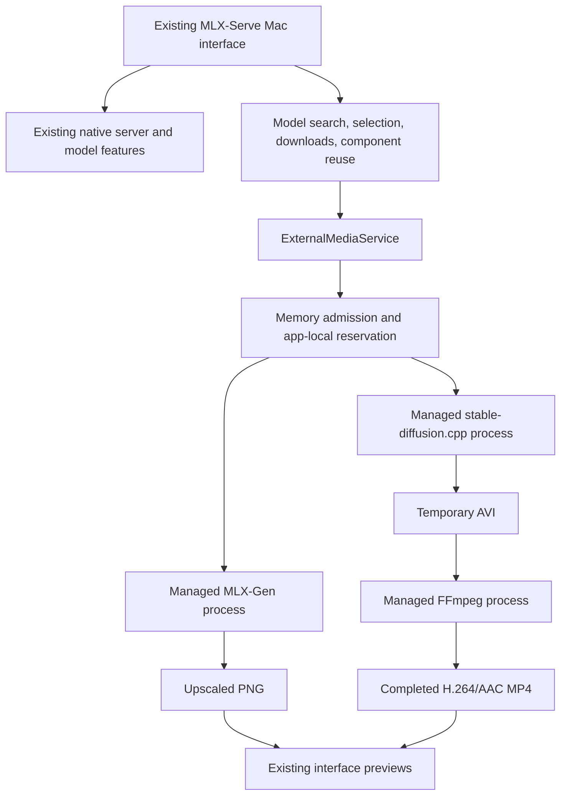

# Case study: one interface, managed media runtimes

## Problem and intended outcome

A capable Apple Silicon Mac already had a broad native MLX-Serve model library, but two workflows remained unavailable in its interface: image upscaling and a compatible uncensored video checkpoint. Running separate front ends would add more apps to manage. Converting or duplicating the existing library would waste storage.

The accepted delivery scope was the existing MLX-Serve application plus verified SeedVR2 upscaling and LTX 2.5 GGUF video workflows. “Support every AI file” was not a feasible architecture contract. A format label alone cannot establish that an engine supports a model family, tensor layout, quantization, auxiliary components, or task.

The project was carried out as AI-assisted, locally validated integration work. This fork owns the adaptation layer and its validation; it builds on the upstream application and inference implementations credited in the README.

## System design

The native server remains responsible for its existing model features. The new media routes run from the Mac interface through an owned-process service; they are not a universal new HTTP runtime gateway. No background daemon is installed for these extra engines.

Model paths are passed directly as argument arrays, without shell interpretation. Checkpoints remain in the model library. The downloader selects the required files and searches for compatible components rather than copying a complete repository into each runtime.

An app-local reservation serializes external jobs and blocks this app's explicit native model loads and local chat starts until the external work ends. Remote chat remains available. The admission floor is:

`required = weight bytes + max(weight bytes / 4, 2 GiB)`

For example, 24 GiB of selected weights requires a 24 + 6 = 30 GiB admission floor. This is not a prediction of peak memory, and it is not a system-wide lock. Another process or an external API client can still load a model after admission.

## What was implemented

| Responsibility | Owning source |
|---|---|
| Direct child lifetime, cancellation, quit notification, stage reporting | `app/Sources/MLXServe/Services/ManagedMediaProcess.swift` |
| One external job, native memory reservation, result ownership across view changes | `ExternalMediaService.swift`, `ExternalMediaRuntime.swift`, `ExternalMediaMemory.swift` |
| Known package discovery, weight readiness, quantized transformer filtering | `ExternalModelCatalog.swift`, `ExternalGGUF.swift`, `DownloadManager.swift`, `HFModels.swift` |
| Compatible auxiliary files, cross-repository downloads, existing-root reuse | `ExternalVideoComponents.swift` and downloader selections |
| Image and video controls inside the existing app | `ExternalUpscaleView.swift`, `ExternalVideoView.swift` |
| Completed MP4 publication, temporary-file cleanup, helper discovery | `ExternalVideoConversion.swift` |
| Existing native video player reuse | `AVPlayerViewRepresentable` in `ChatMediaAttachmentView.swift` |
| Personal app packaging without redundant installer files or source-cache copies | `app/build.sh`: `APP_ONLY`, `SWIFT_SCRATCH_PATH` |

These services live alongside the upstream native application. External helper discovery for conversion returns nil under `MAS_BUILD`; this personal integration is not an App Store distribution.

## Evidence matrix

Results below were observed during the November 5 integration work and recorded in the repository. They are functional tests on one Mac, not broad compatibility or quality claims.

| Area | Observed result | Practical limit |
|---|---|---|
| SeedVR2 3B 4-bit | Search, app download, main selection, 64×64 input to 128×128 PNG | Small functional sample; temporary weights removed |
| SeedVR2 7B 8-bit | Permanent app download; 256×256 input to nonblank 1024×1024 PNG at 4× | Geometric test image; no photorealism or 4K/8K benchmark |
| LTX uncensored Q4_K_M | Permanent transformer and companion downloads; automatic component detection | Only this quantized video configuration was exercised end to end |
| LTX video plus audio | 256×256 / nine frames / one step and 512×512 / 33 frames / four steps | Low settings establish function, not output quality; larger sample took over four minutes |
| Installed video workflow | Fresh generation followed by automatic MP4 conversion; decoded frame visible in native player | Short smoke test, not a long-clip endurance test |
| Memory refusal | Oversized sparse fixture refused before the engine launched | No guarantee against later allocations by other applications |
| Existing chat | Response from LFM3 Omni | Representative request, not all chat/tool/agent behavior |
| Existing image | Qwen-Image 2.1 returned a 256×256 image at one step | Functional image request only |
| Existing sound and speech | Stable Audio WAV and Qwen3-TTS 1.7B bf16 WAV | No listening-quality or voice-cloning evaluation |
| Existing typed decisions | d1 returned typed answers | No decision-accuracy benchmark |
| Existing 3D | Hunyuan3D returned a structured GLB containing 74,992 vertices | Eight steps, octree resolution 128; no aesthetic acceptance claim |
| Data retention | Existing model file path/size manifest, chat rows, and saved two-shot storyboard retained after replacement | File-path/size checks are not a full cryptographic content audit |
| Development cleanup | App and engines started after source/build folders were removed; small Metal computation and video conversion passed | Required Python, FFmpeg, WebP, and installed engines were retained |

The recorded full Swift suite was **4,318 total, 34 skipped, zero failures**. Thus 4,318 − 34 = 4,284 tests were not skipped. That count includes inherited upstream tests. Real-engine and generated-AVI tests use environment-provided executables/fixtures and may skip when those inputs are absent. Raw temporary test logs were removed during the explicitly requested cleanup; the source tests and recorded findings remain. This documentation release does not claim a fresh full-suite run or new hosted CI result.

## What failed, and what changed

### “Playable” did not mean decodable

The first AVI passed stream inspection and reported AVFoundation `isPlayable = true`. The actual Mac preview remained black. An `AVAssetImageGenerator` probe then failed to decode a frame. This invalidated the earlier, weaker playback check.

The app now uses the shared native AVPlayerView wrapper instead of introducing another SwiftUI VideoPlayer surface. It also converts the engine's AVI to H.264/AAC MP4 using an app-owned FFmpeg process. Tests require a decoded frame and an audio track, not just a container header. The final installed app showed the frame in its own interface.

The conversion publishes only the completed MP4, does not overwrite an existing destination, cleans its temporary files, and shares the generation job's cancellation and memory reservation.

### Model-family support was insufficient

The first component combinations did not work. An incompatible VAE and an incompatible encoder path were rejected or failed. A compatible route used the standard LTX 2.5 convolutional video VAE together with the checkpoint pack's audio VAE and Q4 text encoder. Exact component identity matters more than the repository's broad model-family label.

### A runtime arithmetic bug blocked inference

A real generation attempt reached ggml CPU arithmetic and aborted on a mixed F32/F16 operation. A focused arithmetic reproduction led to the patch in `patches/stable-diffusion-ggml-mixed-precision.patch`; the companion C++ check covers eight arithmetic/broadcast cases. The patched engine subsequently produced real video and audio. Reproduction must use that patch and the recorded revisions, not assume an arbitrary runtime build is equivalent.

### Personal signing and release signing are different deliverables

Attempts to retain hardened runtime with ad-hoc or local self-signed identities failed framework library validation. The upstream build script already had a supported ad-hoc personal-build branch. That path launched successfully without changing Gatekeeper, SIP, FileVault, TCC, quarantine, or keychain trust settings. Packaging now removes only signing-incompatible Finder metadata rather than clearing every extended attribute.

This produces a working personal build, not an Apple Developer ID / notarized public installer. The release is therefore labeled a preview and states its runtime and signing prerequisites.

### A plugin probe was not a finished integration

An isolated example media plugin could be loaded and made visible to the original signed server. That did not solve the stock app's native bundle-marker checks or model discovery. No complete MLX-Gen/stable-diffusion.cpp server plugin was shipped. The working solution uses explicit managed routes in the Mac interface.

### Native upscaling PR #248 was useful, but not imported wholesale

[Upstream PR #248](https://github.com/ddalcu/mlx-serve/pull/248) was closed without merging. It exposed useful memory and integration concerns, while its own notes left video restoration and some variants untested. Its native implementation and constants were not interchangeable with this fork's MLX-Gen path. It was treated as research, not proof of compatibility or a patch that could be blindly merged.

### Tests also needed correct measurement boundaries

A host-memory differential test compared samples collected at different times. Concurrent GPU allocations made that look like a formula failure. The test now brackets the subprocess sample with host readings before and after, keeping the existing 5% / 256 MiB numerical tolerance outside the observed range. The application's memory calculation and admission threshold were not relaxed.

## Explicit gaps

- No universal model-format or architecture support. The adapter knows specific packages and task paths.
- Q6/Q8 LTX choices and other listed SeedVR2 variants are not covered by the same end-to-end evidence as the two selected configurations.
- The external video form does not provide every native video feature. Storyboards, arbitrary LoRA workflows, audio conditioning, and image-conditioned generation are not established for this external route. The optional starting-image argument has unit coverage, not a live image-conditioned validation result.
- No external SeedVR2 video-restoration interface or general external-runtime HTTP routing was shipped.
- No measured near-zero refusal rate. “Uncensored” is checkpoint metadata, not a verified safety-filter or behavioral guarantee.
- No 4K/8K, long-video, broad memory-size, thermal, or sustained-performance benchmark.
- No guarantee that another app cannot consume memory after the reservation check.
- No clean-machine one-click runtime provisioning, universal portable bundle, notarization, or App Store release.
- The updater still checks the upstream repository and can overwrite the custom integration.
- Existing-feature checks were representative. They do not certify every permission prompt, device integration, agent workflow, or checkpoint.

## Next engineering steps

1. Provision and pin runtimes through a reproducible, licensed clean-machine install path; validate on a second Mac.
2. Give the fork a separately tested update channel before regular distribution.
3. Measure peak memory across output geometries and add evidence-based resolution admission.
4. Benchmark sensible generation settings and cancellation during real long-running workloads.
5. Extend discovery only when an architecture, quantization, component layout, and live generation have all been verified.

## Provenance

The app code shipped in the first preview is commit `fd2d3d7ab2c0c750911dd12b16f8166fd084f59f`. The preview tag also contains later portfolio/release documentation; the app was not rebuilt just to change documentation. The original native application, inference runtimes, models, and checkpoint packaging are separately credited in the README. No model weights, chat database, prompts from private work, account configuration, or private signing material are release assets.
